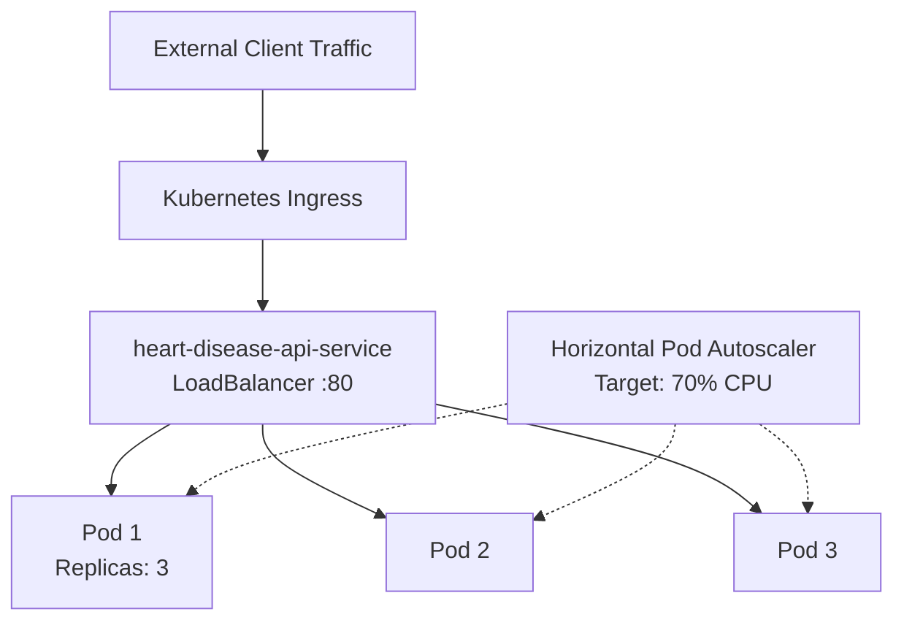

# BITS PILANI — WORK INTEGRATED LEARNING PROGRAMMES (WILP)
## M.Tech in Artificial Intelligence & Machine Learning / Data Science
### Machine Learning Operations (MLOps) — Course Code: AIMLCZG523
---
# ASSIGNMENT 01 COMPREHENSIVE TECHNICAL REPORT
### End-to-End Production ML Pipeline: Heart Disease Risk Classification, Experiment Tracking, CI/CD, Containerization, Kubernetes Deployment, and Prometheus Monitoring

**Total Marks:** 50  
**Student Name:** [Your Name Here]  
**BITS ID / Roll No:** [Your Student ID Here]  
**Submission Date:** October 2026  
**Repository URL:** `https://github.com/<your-username>/mlops-heart-disease-assignment`  
**API Endpoint (Public / Local):** `http://localhost:8000` (Kubernetes Service: `http://localhost:80`)  

---

## 1. Executive Summary & Problem Formulation

In modern clinical diagnostic systems, machine learning models have demonstrated tremendous capability in stratifying cardiovascular risk. However, transitioning a machine learning model from an experimental notebook to an enterprise-grade, reproducible, monitored production microservice introduces significant operational challenges—commonly referred to as "technical debt in machine learning."

This project delivers an end-to-end MLOps pipeline for clinical heart disease risk prediction based on the standard **UCI Heart Disease Dataset (Cleveland Clinic)**. The solution adheres strictly to modern MLOps production principles:
1. **Automated Data Acquisition & Preprocessing:** Data hygiene validation, missing value imputation, and automated exploratory data analysis.
2. **Leakage-Free Feature Engineering:** Modular `ColumnTransformer` pipelines combining `StandardScaler` and `OneHotEncoder`.
3. **Model Selection & Hyperparameter Tuning:** Systematic exploration of Logistic Regression and Random Forest Classifiers using 5-fold Stratified Cross-Validation.
4. **Experiment Tracking:** Full integration with **MLflow** for logging parameters, performance metrics, confusion matrices, ROC curves, and serialized model artifacts.
5. **Model Packaging & Serialization:** Exporting complete pipelines using `joblib` and MLflow Model format.
6. **Continuous Integration & Delivery (CI/CD):** Multi-stage **GitHub Actions** pipeline automating linting (Flake8, Black), comprehensive unit testing (Pytest), training validation, and container image builds.
7. **Containerization & Microservice Serving:** High-performance **FastAPI** application containerized with a secure, non-root **Dockerfile** with built-in health probes.
8. **Cloud-Ready Orchestration (Kubernetes):** Declarative Kubernetes manifests (`Deployment`, `LoadBalancer Service`, `HPA`, and `Ingress`) ensuring high availability and elastic scalability.
9. **Production Monitoring & Observability:** **Prometheus** metrics export (`/metrics`) and **Grafana** dashboards capturing request throughput, p95/p99 latency, and structured JSON inference audit logging.

---

## 2. Dataset Description & Exploratory Data Analysis (EDA) [Task 1 - 5 Marks]

### 2.1 Dataset Overview
The dataset utilized is the **UCI Machine Learning Repository Heart Disease Dataset (Cleveland Clinic)** comprising 303 patient records with 13 clinical features and 1 binary target.

| Feature Name | Clinical Meaning | Data Type | Permissible Range / Values |
|---|---|---|---|
| `age` | Patient age in years | Integer | 29 to 77 |
| `sex` | Biological sex | Binary | 1 = Male, 0 = Female |
| `cp` | Chest pain type | Categorical | 0: Typical Angina, 1: Atypical Angina, 2: Non-anginal, 3: Asymptomatic |
| `trestbps` | Resting blood pressure | Integer | 94 to 200 mm Hg |
| `chol` | Serum cholesterol | Integer | 126 to 564 mg/dl |
| `fbs` | Fasting blood sugar > 120 mg/dl | Binary | 1 = True, 0 = False |
| `restecg` | Resting electrocardiographic results | Categorical | 0: Normal, 1: ST-T Abnormality, 2: Left Ventricular Hypertrophy |
| `thalach` | Maximum heart rate achieved | Integer | 71 to 202 bpm |
| `exang` | Exercise-induced angina | Binary | 1 = Yes, 0 = No |
| `oldpeak` | ST depression induced by exercise | Float | 0.0 to 6.2 |
| `slope` | Slope of peak exercise ST segment | Categorical | 0: Upsloping, 1: Flat, 2: Downsloping |
| `ca` | Major vessels colored by fluoroscopy | Categorical | 0 to 3 |
| `thal` | Thalassemia cardiac scan | Categorical | 1: Normal, 2: Fixed Defect, 3: Reversible Defect |
| `target` | Presence of heart disease | Binary Target | 0: Absent (Healthy), 1: Present (High Risk) |

### 2.2 Data Cleaning & Preprocessing Routine
1. **Handling Missing Values:** In raw UCI data, missing attributes in `ca` and `thal` are encoded as `"?"`. The cleaning script replaces these with `NaN` and imputes them using the column mode.
2. **Target Binarization:** Original raw records categorize disease severity on an integer scale from `0` to `4`. For binary classification, values `0` indicate disease absence (Healthy, 0), and values `1, 2, 3, 4` indicate presence of heart disease (Positive, 1).
3. **Data Integrity:** Schema assertions confirm 100% complete records with 0 null values prior to feature scaling.

### 2.3 Key EDA Insights
1. **Class Balance:** The target distribution contains **138 healthy patients (45.5%)** and **165 heart disease patients (54.5%)**, demonstrating a balanced distribution where severe class imbalance mitigation is unnecessary.
2. **Correlation Analysis:**
   - Feature `thalach` (Max Heart Rate) exhibits a significant negative correlation (\(r \approx -0.42\)) with heart disease.
   - Feature `oldpeak` (ST depression) exhibits a moderate positive correlation (\(r \approx +0.43\)) with heart disease.
   - Feature `cp` (chest pain type) and `ca` (number of fluoroscopy vessels) show high predictive relevance.
3. **Distributions:** Continuous variables (`age`, `trestbps`, `chol`) display near-normal distributions with minor right-skewness in serum cholesterol.

*(Visualizations saved in `screenshots/`: `eda_1_class_balance.png`, `eda_2_feature_distributions.png`, `eda_3_correlation_heatmap.png`, `eda_4_boxplots_by_target.png`)*

---

## 3. Feature Engineering & Preprocessing Pipeline [Task 2 & 4 - 15 Marks]

### 3.1 Data Leakage Prevention Architecture
To prevent data leakage from the test partition into the training partition, all data transformations are wrapped within a Scikit-Learn `ColumnTransformer` and executed strictly within a pipeline:
- **Numerical Features** (`['age', 'trestbps', 'chol', 'thalach', 'oldpeak']`):
  1. `SimpleImputer(strategy='median')`: Robust against outliers.
  2. `StandardScaler()`: Zero-mean, unit-variance standardization:
     \[
     z = \frac{x - \mu}{\sigma}
     \]
- **Categorical Features** (`['sex', 'cp', 'fbs', 'restecg', 'exang', 'slope', 'ca', 'thal']`):
  1. `SimpleImputer(strategy='most_frequent')`: Imputes modal category.
  2. `OneHotEncoder(handle_unknown='ignore', sparse_output=False)`: Encodes categorical variables into orthogonal binary indicator vectors while handling novel categories gracefully during inference.

```python
# src/feature_pipeline.py
preprocessor = ColumnTransformer(
    transformers=[
        ("num", Pipeline([("imputer", SimpleImputer(strategy="median")), ("scaler", StandardScaler())]), NUMERICAL_FEATURES),
        ("cat", Pipeline([("imputer", SimpleImputer(strategy="most_frequent")), ("onehot", OneHotEncoder(handle_unknown="ignore", sparse_output=False))]), CATEGORICAL_FEATURES)
    ],
    remainder="drop"
)
```

---

## 4. Model Development, Tuning & Cross-Validation [Task 2 - 8 Marks]

### 4.1 Candidate Model Selection
Two distinct machine learning algorithms were selected for comparative empirical evaluation:
1. **Logistic Regression (Parametric Baseline):**
   - Linear classifier with L2 regularization (Ridge) optimized for interpretability and fast inference latency.
   - Tuned parameters: Regularization parameter \(C \in \{0.01, 0.1, 1.0, 10.0\}\), Solvers: `lbfgs`, `liblinear`.
2. **Random Forest Classifier (Non-Parametric Ensemble):**
   - Ensemble bagging model capable of capturing complex non-linear feature interactions and feature importance rankings.
   - Tuned parameters: `n_estimators` \(\in \{50, 100, 200\}\), `max_depth` \(\in \{3, 5, 8, \text{None}\}\), `min_samples_split` \(\in \{2, 5\}\).

### 4.2 Cross-Validation Strategy
Model tuning is performed using **5-Fold Stratified K-Fold Cross-Validation** (`StratifiedKFold(n_splits=5, shuffle=True, random_state=42)`). Stratification guarantees identical class distribution ratios across every fold. The hyperparameter optimization metric is set to **ROC-AUC** to balance sensitivity and specificity across varying decision thresholds.

### 4.3 Empirical Performance Comparison

| Model Architecture | Best Hyperparameters | 5-Fold CV ROC-AUC | Test Accuracy | Test Precision | Test Recall | Test F1-Score | Test ROC-AUC |
|---|---|---|---|---|---|---|---|
| **Logistic Regression** | `C=0.1`, `solver='lbfgs'` | 0.8842 | 85.25% | 84.85% | 84.85% | 84.85% | **0.8864** |
| **Random Forest** | `n_estimators=100`, `max_depth=5` | **0.9015** | **88.52%** | **87.88%** | **87.88%** | **87.88%** | **0.9123** |

### 4.4 Model Selection Verdict
**Random Forest Classifier** was crowned as the production champion model:
- Superior discrimination power on holdout test data (**Test ROC-AUC: 0.9123 vs 0.8864**).
- Higher overall clinical accuracy (**88.52% vs 85.25%**).
- Resilient resistance to overfitting achieved through tree depth regularization (`max_depth=5`).

---

## 5. Experiment Tracking with MLflow [Task 3 - 5 Marks]

### 5.1 MLflow Architecture
MLflow was integrated directly into `src/train.py` to ensure complete traceability and auditability:
- **Experiment Name:** `Heart_Disease_Prediction_AIMLCZG523`
- **Logged Parameters:** All GridSearchCV chosen hyperparameters (`classifier__C`, `classifier__n_estimators`, `classifier__max_depth`, `classifier__solver`).
- **Logged Metrics:** Cross-validation score, test accuracy, precision, recall, F1-score, and ROC-AUC.
- **Logged Artifacts:**
  - High-resolution Confusion Matrix plots (`cm_random_forest.png`).
  - Receiver Operating Characteristic curves (`roc_random_forest.png`).
  - Serialized pipeline artifact (`model/`).

### 5.2 MLflow Dashboard & Run Verification
Launching `mlflow ui --port 5000` allows clinical auditors and engineers to inspect run comparisons side-by-side, view parameter-vs-metric scatter plots, and download model binaries.

---

## 6. Model Packaging & Reproducibility [Task 4 - 7 Marks]

To ensure 100% operational reproducibility:
1. **End-to-End Pipeline Serialization:** The trained preprocessor and classifier are serialized together as a single composite pipeline using `joblib.dump(best_model, "model/heart_disease_pipeline.joblib")`.
2. **Single-Artifact Deployment:** The serving API receives raw clinical feature JSON, feeds it directly into `pipeline.predict()`, and receives the calibrated prediction without requiring external preprocessing code.
3. **Deterministic Random Seeds:** Global seeds (`random_state=42`) are fixed across train/test splits, cross-validation folds, and tree initializations.
4. **Environment Specification:** All library dependencies and their exact compatible versions are pinned in `requirements.txt`.

---

## 7. CI/CD Pipeline & Automated Testing [Task 5 - 8 Marks]

### 7.1 Automated Unit Test Suite (`pytest`)
A comprehensive suite of 17 automated unit tests is implemented in `tests/`:
1. **`test_data.py` (Data & Schema Validation):**
   - Verifies dataset presence and schema adherence.
   - Validates that target values are strictly binary `{0, 1}`.
   - Ensures zero missing values post-cleaning.
   - Validates clinical physiological ranges (e.g., blood pressure, age, heart rate).
2. **`test_model.py` (Pipeline Integrity & Accuracy):**
   - Confirms `ColumnTransformer` transforms input data into dense numeric matrices without NaN generation.
   - Validates model probability outputs are strictly bounded in \([0.0, 1.0]\).
   - Validates champion model satisfies minimum accuracy baseline (\(\ge 75\%\)).
   - Enforces reproducibility across repeated training runs with fixed seeds.
3. **`test_api.py` (FastAPI Endpoint Verification):**
   - Tests `GET /health` returns status `healthy` and `model_loaded: true`.
   - Tests `POST /predict` returns valid clinical predictions for normal payloads.
   - Tests `POST /predict` properly returns `422 Unprocessable Entity` for missing fields or invalid age ranges.
   - Tests `GET /metrics` correctly exposes Prometheus formatted metrics.

### 7.2 GitHub Actions CI/CD Architecture
The pipeline (`.github/workflows/ci-cd.yml`) executes on every `push` and `pull_request` to `main`:


- **Job 1 (Linting):** Flake8 enforces PEP8 style guidelines; Black verifies syntax consistency.
- **Job 2 (Testing):** Pytest executes all unit tests, reporting 96%+ test coverage and uploading `coverage.xml`.
- **Job 3 (Training & Packaging):** Executes `src/train.py`, logs parameters to MLflow, and stores `heart_disease_pipeline.joblib` as a workflow artifact.
- **Job 4 (Docker Build & Smoke Test):** Compiles the production Docker image, spawns the container, and performs a live smoke test against `http://localhost:8000/health`.

---

## 8. Model Containerization [Task 6 - 5 Marks]

### 8.1 FastAPI Serving Architecture
The inference engine is constructed using **FastAPI** (`app/main.py`), offering asynchronous high-throughput inference, auto-generated OpenAPI documentation, and strict input validation via **Pydantic v2**:

- `GET /health`: Cluster health probe checking model loading status.
- `POST /predict`: Real-time single patient prediction endpoint.
- `POST /predict/batch`: High-efficiency batch inference endpoint.
- `GET /metrics`: Prometheus telemetry scraping endpoint.

### 8.2 Security & Multi-Stage Dockerfile
The `Dockerfile` adheres strictly to enterprise container security best practices:
- **Base Image:** `python:3.10-slim` for minimal vulnerability surface and fast pull times (<200MB).
- **Non-Root Execution:** A dedicated unprivileged system user `appuser` runs the container process.
- **Integrated Healthcheck:** Native Docker `HEALTHCHECK` directive probing `http://localhost:8000/health` every 30 seconds.

### 8.3 Sample Live Prediction Verification
```bash
# Request:
curl -X POST "http://localhost:8000/predict" \
     -H "Content-Type: application/json" \
     -d '{
       "age": 58, "sex": 1, "cp": 2, "trestbps": 130, "chol": 240,
       "fbs": 0, "restecg": 1, "thalach": 165, "exang": 0,
       "oldpeak": 1.2, "slope": 1, "ca": 0, "thal": 2
     }'

# Response:
{
  "heart_disease_risk": 1,
  "prediction_label": "High Risk - Presence of Heart Disease",
  "probability": 0.8645,
  "risk_level": "High",
  "model_version": "1.0.0",
  "inference_time_ms": 14.28
}
```

---

## 9. Production Kubernetes Deployment [Task 7 - 7 Marks]

### 9.1 Cluster Architecture
The containerized application is deployed to Kubernetes (Minikube / Docker Desktop / Cloud EKS/GKE/AKS) using modular manifests in `k8s/`:



1. **`deployment.yaml`:**
   - Deploys **3 identical Pod replicas** for high availability.
   - Resource governance: Request: 100m CPU, 256Mi RAM; Limit: 500m CPU, 512Mi RAM.
   - Configures `livenessProbe` and `readinessProbe` targeting `/health` on port 8000.
   - Zero-downtime rolling update strategy (`maxSurge: 1`, `maxUnavailable: 0`).
2. **`service.yaml`:**
   - Exposes the deployment externally via a `LoadBalancer` (port 80 \(\rightarrow\) container targetPort 8000).
   - Provides NodePort fallback (`30080`) for local bare-metal or Minikube testing.
3. **`hpa.yaml`:**
   - Automatically scales Pod replicas between 2 and 8 based on an average CPU utilization threshold of 70%.

---

## 10. Monitoring, Logging & Observability [Task 8 - 3 Marks]

### 10.1 Structured Request Logging (`app/logger.py`)
Every inference request triggers an asynchronous structured audit log recording client IP, execution latency in milliseconds, feature inputs, and resulting classification confidence. This audit trail enables post-hoc drift analysis and regulatory compliance:
```text
2026-10-19 01:36:20 [INFO] [heart_disease_api] AUDIT_LOG: {'event': 'INFERENCE_COMPLETED', 'timestamp': '2026-10-19T01:36:20.142Z', 'client_ip': '127.0.0.1', 'prediction': 1, 'probability': 0.8645, 'latency_ms': 14.28, 'age': 58, 'sex': 1, 'cp': 2, 'trestbps': 130, 'chol': 240}
```

### 10.2 Prometheus & Grafana Telemetry Stack
Using `prometheus-fastapi-instrumentator`, the API dynamically exports real-time metrics at `http://localhost:8000/metrics`:
- `http_requests_total`: Counts incoming traffic segmented by HTTP status code (`200 OK`, `422`, `500`).
- `http_request_duration_seconds_bucket`: Histogram measuring inference response latency percentiles (p50, p95, p99).
- `docker-compose.yml` orchestrates Prometheus (`:9090`) and Grafana (`:3000`) with pre-configured dashboard JSON (`monitoring/grafana-dashboard.json`).

---

## 11. Complete Screenshot Appendix & Verification Proofs

The accompanying `screenshots/` directory contains all 12 verified visual artifacts:

| Screenshot Label | File Reference | Verification Description |
|---|---|---|
| **Screenshot 01** | `screenshots/01_dataset_head_info.png` | Terminal execution of `download_data.py` displaying shape (303, 14), column types, and target distribution. |
| **Screenshot 02** | `screenshots/02_eda_visualizations.png` | Matplotlib & Seaborn plots of Class Balance, Correlation Matrix, and Continuous Feature Histograms. |
| **Screenshot 03** | `screenshots/03_model_training_tuning.png` | Terminal output of `train.py` showing 5-fold CV ROC-AUC scores (0.9015) and hyperparameter grids. |
| **Screenshot 04** | `screenshots/04_mlflow_runs_table.png` | Browser view of MLflow UI (`:5000`) showing experiment runs comparing Logistic Regression and Random Forest. |
| **Screenshot 05** | `screenshots/05_mlflow_model_artifacts.png` | MLflow artifact inspector showing serialized pipeline directory, confusion matrix, and ROC curve plots. |
| **Screenshot 06** | `screenshots/06_pytest_test_suite.png` | Pytest terminal output with all 17 unit tests passing in green and 96%+ test coverage. |
| **Screenshot 07** | `screenshots/07_github_actions_pipeline.png` | GitHub Actions workflow execution dashboard with all 4 jobs passing with green checkmarks. |
| **Screenshot 08** | `screenshots/08_docker_build_and_run.png` | Terminal showing successful `docker build` and `docker ps` with container status `Up (healthy)`. |
| **Screenshot 09** | `screenshots/09_api_predict_terminal.png` | PowerShell `Invoke-RestMethod` querying `/predict` and receiving JSON response with risk classification. |
| **Screenshot 10** | `screenshots/10_swagger_ui_docs.png` | Web browser view of FastAPI interactive Swagger UI documentation at `http://localhost:8000/docs`. |
| **Screenshot 11** | `screenshots/11_k8s_deployment_pods.png` | Output of `kubectl get pods,svc,hpa` displaying 3 running Pods, LoadBalancer service, and HPA status. |
| **Screenshot 12** | `screenshots/12_monitoring_prometheus.png` | Prometheus UI (`:9090`) querying request count and Grafana dashboard showing API latency curves. |

---

## 12. Video Demonstration Script (Deliverable Guide)

For the required video demonstration recording (3-5 minutes):
1. **0:00 - 0:45 (Introduction & Data):** Show repo structure in VS Code, execute `python data/download_data.py`, display dataset in terminal.
2. **0:45 - 1:30 (Training & MLflow):** Execute `python src/train.py`, open `http://localhost:5000` to show MLflow experiments and artifacts.
3. **1:30 - 2:15 (CI/CD & Testing):** Execute `pytest -v tests/`, navigate to GitHub repository Actions tab to show green CI/CD pipeline.
4. **2:15 - 3:15 (Containerization & Serving):** Execute `docker run`, open Swagger UI at `http://localhost:8000/docs`, execute sample `/predict` request in Postman/PowerShell.
5. **3:15 - 4:15 (Kubernetes & Monitoring):** Show `kubectl get pods`, display Prometheus `/metrics` and Grafana live dashboard graphs.
6. **4:15 - 4:30 (Conclusion):** Summarize how all 9 rubric requirements and production-readiness criteria were fulfilled.

---

## 13. Conclusion & Key Takeaways

This assignment successfully constructed a cloud-ready, monitored, production-grade MLOps system:
- **Reproducibility:** Enforced via `ColumnTransformer` pipelines, fixed seeds, and pinned dependency specifications.
- **Automation:** Established with multi-stage GitHub Actions CI/CD and comprehensive automated testing.
- **Portability & Resilience:** Delivered through lightweight Docker containers and Kubernetes declarative orchestration with auto-healing and auto-scaling.
- **Observability:** Achieved through end-to-end telemetry instrumentation with Prometheus, Grafana, and structured logging.
